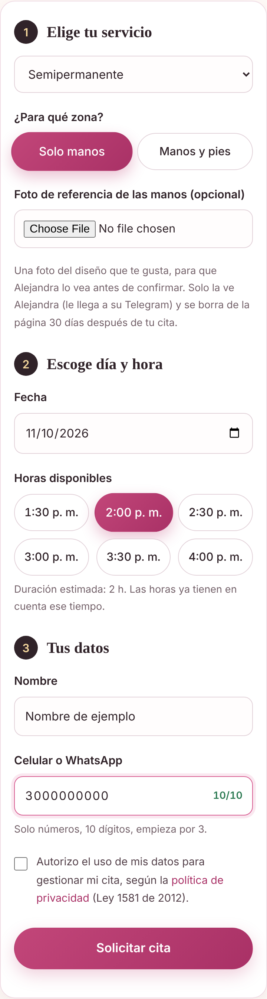
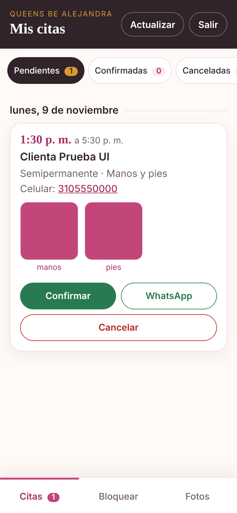

# Queens Be Alejandra · Sistema de citas

Página web y sistema de reservas para un salón de uñas real (Queens Be Alejandra Nail Salon, Colombia). La clienta elige servicio, día y hora; el horario queda apartado y la dueña confirma o cancela desde un panel privado pensado para el celular.

Proyecto de aprendizaje (SENA, Análisis y Desarrollo de Software) construido de punta a punta: diseño, base de datos, API, seguridad, pruebas y publicación.

| Reserva (celular) | Panel de la dueña |
|---|---|
|  |  |

*Las capturas usan datos de ejemplo.*

## Qué hace

**Para la clienta**
- Elige servicio y zona (manos, o manos y pies), y ve solo las horas libres de cada día.
- Puede adjuntar una foto de referencia del diseño que quiere (opcional).
- La solicitud queda **pendiente** hasta que la dueña la confirma. Nada se confirma solo.
- Al enviar, se abre WhatsApp con el mensaje ya escrito; lo envía la clienta.

**Para la dueña (panel `/admin`)**
- Confirma o cancela citas, con historial.
- Bloquea días completos, varios días (vacaciones) o unas horas.
- Sube y quita fotos de la galería pública.
- Recibe un aviso por Telegram con cada solicitud nueva.

## Decisiones técnicas

- **El cruce de horarios lo impide la base de datos**, no solo el código. Una restricción `EXCLUDE USING gist` de PostgreSQL sobre el rango de tiempo rechaza dos citas que se solapan, incluso si dos clientas envían a la vez. Un *trigger* hace lo mismo con los bloqueos. La API traduce ese error (`23P01`) a un `409`.
- **Las reglas viven en el servidor.** El navegador solo muestra lo que el servidor le dice: horario, duración, horas pasadas, domingos cerrados. La página valida para dar comodidad; el servidor valida todo otra vez.
- **Zona horaria explícita.** Colombia es UTC-5 sin horario de verano; todas las horas se calculan con esa regla y se guardan como `TIMESTAMPTZ`.
- **Fotos tratadas como entrada no confiable.** Se revisa el contenido real con `sharp` (no la extensión ni el tipo declarado), se endereza, se reduce y se recodifica como JPEG: así se pierden los datos ocultos (EXIF, ubicación GPS). La cita y sus fotos se guardan en una sola transacción.
- **Sin frameworks de frontend.** HTML, CSS y JavaScript sin dependencias; el DOM del panel se construye con `textContent` para evitar XSS.

## Seguridad

- Consultas parametrizadas en todo el acceso a datos.
- Panel con autenticación real: clave con `scrypt`, sesión en cookie `httpOnly` + `SameSite=Strict` (`secure` en producción), solo el hash del token en la base, límite de intentos de login y rechazo de peticiones de otro origen.
- Límite de solicitudes por IP, cabeceras de seguridad con `helmet`, tamaño máximo de cuerpo por ruta.
- Credenciales solo en variables de entorno (`.env` fuera de Git).
- Datos personales: consentimiento explícito (Ley 1581 de 2012), política de privacidad, las fotos de referencia se borran 30 días después de la cita y los datos a los 12 meses (`npm run datos:limpiar`).
- El aviso por Telegram no incluye nombre ni celular de la clienta.

## Pruebas

```
npm test
```

74 pruebas con `node:test` contra una base PostgreSQL real de pruebas: reglas de horario, API, concurrencia (varias reservas simultáneas a la misma hora, una sola gana), autenticación y permisos, bloqueos, fotos (formato, tamaño, EXIF), y avisos con un Telegram simulado.

## Tecnologías

Node.js 20+ · Express 5 · PostgreSQL · `pg` · `sharp` · `helmet` · `express-rate-limit` · HTML/CSS/JS · Git y GitHub.

## Cómo correrlo en tu computador

Requisitos: Node.js 20 o superior y PostgreSQL.

```
npm install
copy .env.example .env      # y escribe tu DB_PASSWORD en .env
npm run db:preparar         # crea la base y las tablas
npm run admin:crear         # crea el usuario del panel
npm start
```

Luego abre http://localhost:3000 (página) y http://localhost:3000/admin (panel).

El resto (avisos por Telegram, copias de seguridad, publicación gratis con Render y Neon) está en [docs/guia.md](docs/guia.md).

## Estructura

```
public/            página de la clienta, política de privacidad y panel (public/admin)
src/app.js         aplicación Express
src/reglas.js      horarios, duraciones y validaciones
src/routes/        citas (pública), admin (panel), fotos (galería)
src/auth.js        sesiones y claves
src/avisos.js      avisos por Telegram
db/schema.sql      tablas, restricción anti-cruce y trigger de bloqueos
scripts/           crear usuario, copias de seguridad, limpieza de datos, Telegram
tests/             pruebas
```

## Limitaciones conocidas

- Las duraciones por servicio se configuran en `src/reglas.js` (hoy todos los servicios de una misma zona duran igual).
- Los avisos a la clienta (confirmación, recordatorios) no son automáticos: se hacen con el botón de WhatsApp del panel. Hacerlos automáticos requeriría la API oficial de WhatsApp.
- El plan gratuito de hosting con el que se publicó se duerme sin visitas.
